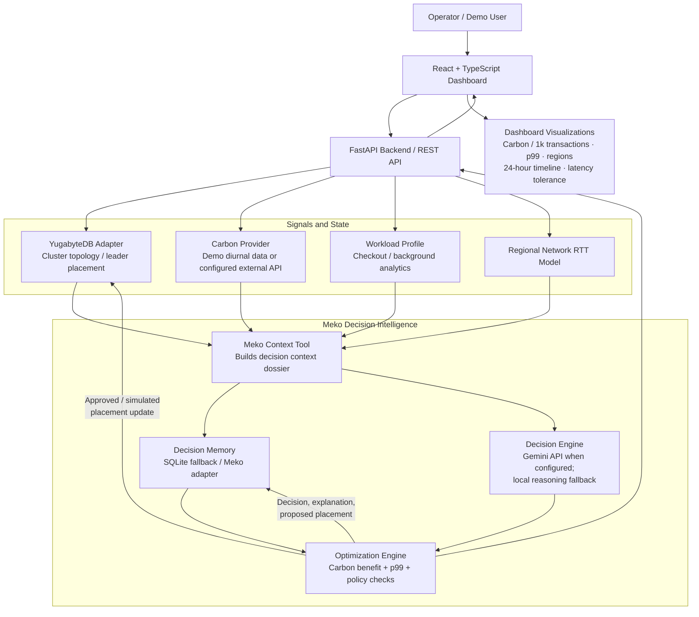

# CLOVER — Follow the Green Leaders

> **Reducing carbon emissions without affecting user experience.**

## Team Information

| Field | Details |
|---|---|
| **Team name** | `Cloverr ` |
| **Team members** | `Shivangi · Kanak Jangra · Yash Vashishth ` |
| **College** | `Gurugram University` |
| **Hackathon** | `HackCBS 9.0` |

---

## 1. Problem Statement

In a multi-region YugabyteDB deployment, the regions hosting tablet leaders handle writes. Keeping write leaders in one fixed region can waste opportunities to use cleaner or cheaper electricity elsewhere. Grid carbon intensity and electricity prices change throughout the day, but moving leaders also changes the network path between clients and the leaders. A move that reduces emissions may increase write latency—especially for latency-sensitive services such as checkout.

**The challenge:** continuously identify when another region offers a meaningful carbon or cost advantage, estimate the latency impact of moving leaders there, and make a safe placement decision within an operator-defined latency budget.

Clover explores this trade-off:

- **Reduce:** estimated CO₂ emissions per 1,000 transactions (and optionally account for electricity cost).
- **Protect:** p99 write latency and workload-specific latency limits.
- **Adapt:** evaluate changing regional grid conditions throughout a 24-hour day.
- **Learn:** retain the outcomes of earlier placement decisions so that risky moves can be avoided in similar conditions.

The goal is not to minimize carbon at any cost. It is to find the cleanest practical placement that stays within the workload's performance requirements.

## 2. Our Solution

Clover is a carbon-aware database placement decision and demonstration platform built around three ideas:

1. **YugabyteDB is the distributed database target.** The design models a multi-region cluster and the placement of tablet leaders. The backend includes a YugabyteDB adapter and a guarded live-mode path; the current out-of-the-box experience runs in simulation mode.
2. **Meko is the decision context and memory layer.** It combines regional carbon conditions, workload characteristics, latency estimates, policy limits, and previous decision outcomes. It can surface historical warnings—for example, that a particular region shift caused a checkout p99 spike around the evening peak.
3. **The dashboard makes the trade-off visible.** It shows regional conditions, leader distribution, a 24-hour timeline, estimated carbon savings, p99 latency, and a latency-tolerance control. Users can advance or replay the simulated day and inspect the resulting decisions.

### What happens during a decision?

1. Read the current workload, leader placement, regional grid conditions, and network-latency estimates.
2. Build a context dossier containing the current state, candidate target regions, policy limits, and relevant memory.
3. Evaluate candidate placements for carbon benefit and predicted p99 impact.
4. Reject or maintain placement when the move breaches the latency budget, fails the minimum carbon-benefit threshold, or is otherwise unsuitable.
5. When a candidate is accepted, update the simulated leader placement and record the decision and its predicted outcome.
6. Use stored outcomes as context for later decisions.

## 3. System Architecture



### Main components

| Component | Responsibility |
|---|---|
| **React + TypeScript frontend** | Interactive dashboard, regional monitor, topology view, Meko decision panel, memory history, and carbon-versus-latency charts. |
| **FastAPI backend** | REST API, service orchestration, health/status reporting, topology and workload endpoints, optimization and decision-history endpoints. |
| **YugabyteDB adapter** | Checks database connectivity, inspects topology, and contains the guarded live placement-change integration. |
| **Carbon provider** | Supplies regional carbon-intensity data. Demo mode uses deterministic hourly profiles; an external-provider integration is configurable. |
| **Meko context tool + memory adapter** | Collects context and retrieves/stores prior decisions and outcomes. Local SQLite persistence is available when an external Meko service is not configured. |
| **Gemini AI service** | Uses Gemini when an API key is configured; otherwise uses the built-in local reasoning fallback. |
| **Optimization engine** | Evaluates carbon reduction against predicted p99 latency, SLA tolerance, minimum benefit, and cooldown/policy constraints. |

## 4. What We Are Demonstrating

### A. A changing electricity grid

The prototype models three regions:

- **Mumbai** — `ap-south-1`
- **Frankfurt** — `eu-central-1`
- **Northern Virginia** — `us-east-1`

Each region has an hourly carbon-intensity profile. The profiles represent changing grid conditions, including daytime renewable generation and evening demand peaks. The demo also includes illustrative electricity-price curves and an inter-region network RTT matrix.

### B. Workload-aware leader placement

The model includes workload profiles such as **Checkout** and **Background Analytics**. Checkout is treated as more latency-sensitive. The latency model estimates the effect of client traffic distribution and network RTT to the region hosting leaders.

### C. Meko's decision and memory loop

Meko's context layer brings together:

- Current and candidate leader regions
- Regional carbon intensity and (where enabled) electricity cost
- Workload traffic and latency sensitivity
- Predicted p99 latency change
- The configured latency budget and minimum carbon-reduction requirement
- Similar previous decisions and recorded outcomes

The decision engine uses this context to recommend whether to move leaders or keep the current placement. Decision history is persisted locally in SQLite by default, with an adapter boundary for an external Meko service.

### D. A measurable carbon / latency trade-off

The dashboard is designed to make the central trade-off understandable at a glance:

- Estimated **gCO₂ per 1,000 transactions**
- Estimated p99 latency
- Regional grid conditions and current leader distribution
- Carbon savings over the simulated day
- A **latency-tolerance slider** that changes which optimizations are acceptable
- A 24-hour simulator with play, pause, hour-step, and replay controls
- Meko's recommendation, explanation, and memory of earlier outcomes

The demo's charts are estimates produced by the project's energy, grid, workload, and latency models—not measurements from a production workload.

## 5. Technology Stack

| Layer | Technology |
|---|---|
| Frontend | React 18, TypeScript, Vite |
| Charts and visualization | Recharts, custom React components |
| Backend | Python 3.11, FastAPI, Pydantic |
| Database target | YugabyteDB (YSQL / PostgreSQL-compatible interface) |
| Decision context and memory | Meko adapter, local SQLite fallback |
| AI decision support | Google Gemini API when configured; local fallback otherwise |
| Carbon data | Built-in demo profiles; configurable external carbon-intensity provider |
| Deployment | Docker, Docker Compose, Nginx |

## 6. Running the Demo

### Requirements

- Docker and Docker Compose (recommended), **or**
- Python 3.11+ and Node.js 20+

### Option A — Docker Compose

From the project root:

```bash
docker compose up --build
```

Open:

- **Dashboard:** http://localhost:3000
- **Backend API:** http://localhost:8000
- **API documentation:** http://localhost:8000/docs
- **Health endpoint:** http://localhost:8000/api/health

The default Compose configuration starts the frontend and backend in **SIMULATION** mode. It does not require a live YugabyteDB cluster, carbon API key, Meko credentials, or Gemini API key.

To stop the services:

```bash
docker compose down
```

### Option B — Run frontend and backend separately

**Backend**

```bash
cd backend
python -m venv .venv
```

Activate the environment:

```bash
# Windows PowerShell
.venv\Scripts\Activate.ps1

# macOS / Linux
source .venv/bin/activate
```

Install dependencies and start the API:

```bash
pip install -r requirements.txt
uvicorn app.main:app --reload --host 0.0.0.0 --port 8000
```

**Frontend** — in a second terminal:

```bash
cd frontend
npm install
npm run dev
```

Open the Vite URL printed in the terminal (normally http://localhost:5173).

### Environment configuration

Copy `.env.example` to `.env` and change only the settings needed for your environment.

| Variable | Purpose | Default / demo behaviour |
|---|---|---|
| `OPERATING_MODE` | `SIMULATION` or `LIVE` database mode | `SIMULATION` |
| `CARBON_PROVIDER` | `DEMO` or `EXTERNAL` | `DEMO` |
| `CARBON_API_KEY` | External carbon provider credential | Not required for demo |
| `CARBON_API_URL` | Optional external provider endpoint | Provider default is used if configured |
| `YUGABYTEDB_HOST` | YugabyteDB host | `localhost` |
| `YUGABYTEDB_PORT` | YSQL port | `5433` |
| `YUGABYTEDB_DATABASE` | Database name | `yugabyte` |
| `YUGABYTEDB_USER` / `YUGABYTEDB_PASSWORD` | Database credentials | Demo does not require them |
| `MEKO_ENABLED` | Enable configured Meko integration | `false` (local SQLite memory fallback) |
| `MEKO_API_ENDPOINT` / `MEKO_API_KEY` | Meko service configuration | Optional |
| `GEMINI_API_KEY` | Gemini decision API key | Blank uses local reasoning fallback |
| `GEMINI_MODEL` | Gemini model identifier | `gemini-1.5-flash` |
| `ACTIVE_WORKLOAD` | Workload profile | `CHECKOUT` |
| `MAX_LATENCY_INCREASE_MS` | Maximum permitted latency increase | `20` ms |
| `MIN_CARBON_REDUCTION_PCT` | Minimum carbon reduction to consider | `10` % |
| `COOLDOWN_SECONDS` | Minimum time between changes | `120` seconds |

Do not commit `.env` or API keys to source control.

## 7. Important Prototype Scope and Limitations

This repository is a **working prototype and simulation-led demonstration**, not yet a production-ready autonomous database controller.

- The default frontend experience uses deterministic in-browser simulation data and local browser persistence for its interactive demo.
- The backend defaults to `OPERATING_MODE=SIMULATION` and uses demo carbon profiles unless an external provider is configured.
- The backend has a Meko-compatible adapter and local SQLite memory implementation. The external Meko forwarding path is a placeholder and must be connected to the actual Meko API contract before claiming cloud Meko execution.
- Gemini is optional. Without a key, the backend uses its local reasoning engine.
- The YugabyteDB adapter contains connectivity/topology and live-mode integration scaffolding. The placement-change path must be validated against the exact YugabyteDB version, schema/tablespace configuration, and documented leader-preference procedure before use on a real cluster. The current adapter's generated SQL should be reviewed and corrected/verified before production use.
- The carbon, energy, transaction, and p99 values in the demo are model-based estimates. They should not be presented as live telemetry unless connected to and validated against real data sources.
- Live leader movement can affect availability and application latency. Production deployment needs explicit operational safeguards, monitoring, rollback, permissions, and a controlled rollout process.

**Safety principle:** demonstrate in simulation first. Do not point this prototype at a production cluster or enable automated live placement changes without validating the YugabyteDB commands and adding production-grade approval, observability, and rollback controls.


## 8. Expected Impact

Clover demonstrates a practical approach to making distributed database placement carbon-aware without ignoring user experience:

- Shift write leadership toward cleaner regional electricity when the workload can tolerate the network impact.
- Avoid moves whose predicted p99 penalty exceeds the configured latency budget.
- Use workload context and decision history to make placement decisions more informed.
- Give operators a visible, explainable carbon-versus-performance control rather than a blind “greenest region wins” rule.

**In one sentence:** Clover uses Meko's context and memory to help YugabyteDB follow cleaner electricity through the day—while keeping the cost of that choice visible in p99 latency.
